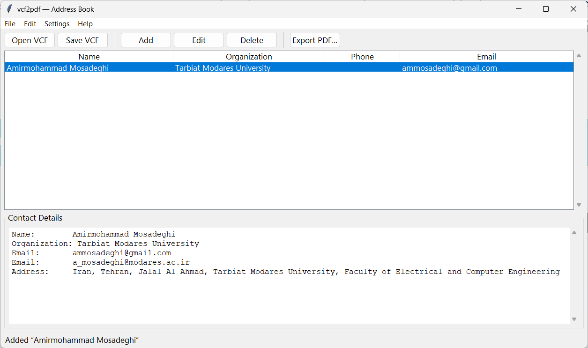

# vcf2pdf


Turn a vCard (`.vcf`) address book into a clean, printable PDF directory.

`vcf2pdf` reads the contacts exported from your phone, Google Contacts, or
any other app that saves `.vcf` files, and produces a tidy PDF address book:
a cover page, then one page per letter, with two-column contact listings and
striped rows. Names and addresses in Persian or Arabic are rendered correctly
in any PDF viewer.

It comes in two flavours:

- **`vcf2pdf-gui`** — a windowed app for Windows. Open a `.vcf`, edit
  contacts, and export the PDF with a couple of clicks.
- **`vcf2pdf`** — a command-line tool for scripting or batch use.

---

## Download

Grab the latest release from GitHub:

**https://github.com/mosadeghi/vcf2pdf/releases/**

Each release ships standalone Windows executables — no Python installation
needed:

| File | What it is |
| --- | --- |
| `vcf2pdf-gui.exe` | The windowed app. Double-click to run. |
| `vcf2pdf.exe` | The command-line tool. Run from a terminal. |

Download the file you want, put it somewhere convenient (e.g. your Desktop
or `C:\Tools`), and run it. That's it — no installer, no dependencies.

---

## Getting started (GUI)

1. Double-click **`vcf2pdf-gui.exe`**.
2. Click **Open VCF** and pick your `.vcf` file.
3. Your contacts appear in a list. Click one to see its details below.
4. Edit, add, or delete contacts as needed.
5. When you're happy, click **Export PDF…**, choose a title and an output
   location, and save.

### What you can do

| Action | How |
| --- | --- |
| **Open** a `.vcf` file | Toolbar → **Open VCF** (or `Ctrl+O`) |
| **Save** changes back to `.vcf` | Toolbar → **Save VCF** (or `Ctrl+S`) |
| **Add** a new contact | Toolbar → **Add** (or `Ctrl+N`) |
| **Edit** the selected contact | Toolbar → **Edit** (or `F2`) |
| **Delete** selected contacts | Toolbar → **Delete** (or `Del`) |
| **Export** the PDF | Toolbar → **Export PDF…** (or `Ctrl+P`) |
| **Change the PDF font** | Menu → **Settings → Choose PDF Font…** |

You can select more than one contact at a time (click, then Shift- or
Ctrl-click) to delete several at once. Double-clicking a row also opens the
editor.

### What the PDF looks like

1. **Cover page** with the title and total contact count.
2. **One page per letter** — a coloured letter badge, a "N contacts"
   caption, then a two-column table with zebra stripes.
3. **Page numbers** at the bottom of every page.

Persian and Arabic text is automatically reshaped and reordered, so names
and addresses appear correctly even in viewers that don't natively handle
right-to-left scripts.

---

## Getting started (command line)

If you prefer the terminal, run:

```
vcf2pdf contacts.vcf -o address-book.pdf
```

That produces `address-book.pdf` from `contacts.vcf`.

Common options:

| Flag | Default | Meaning |
| --- | --- | --- |
| `vcf` | — | Input `.vcf` file (required). |
| `-o`, `--output` | `contacts.pdf` | Where to write the PDF. |
| `--title` | `Contacts` | Title on the cover page. |
| `--font` | auto-detected | Path to a `.ttf` font to use for the PDF. |
| `--font-bold` | auto-detected | Optional bold companion to `--font`. |
| `-h`, `--help` | — | Show usage and exit. |

Example with a custom title:

```
vcf2pdf contacts.vcf -o "Team Directory.pdf" --title "Team Directory"
```

Run `vcf2pdf --help` for the full list.

---

## Fonts and Persian/Arabic text

The PDF needs a font that covers the script your contacts are written in.
The tool looks for a suitable font automatically:

- **Windows** — Tahoma, Segoe UI, or Arial (always present).
- **Linux** — Noto Naskh Arabic or DejaVu Sans.
- **macOS** — Arial Unicode.

If none is found, you'll see an error telling you to point at a font
explicitly. In the GUI, use **Settings → Choose PDF Font…**. On the command
line, pass `--font C:\path\to\font.ttf`.

Good choices for Persian: **Tahoma**, **Vazirmatn**. For Arabic: **Noto
Naskh Arabic**, **Amiri**. Any Unicode `.ttf` with the right glyphs works.

---

## Troubleshooting

**The app opens and closes immediately.**
Something failed during startup — usually no usable font could be found.
Make sure Tahoma or Segoe UI is installed (they are on every standard
Windows install). If you're on a stripped-down system, try the
command-line version so you can see the error message.

**"No Unicode font found".**
Install a Unicode font, or point the tool at one explicitly (see the
section above). On Windows, Tahoma is present by default and will be used
automatically.

**Persian/Arabic letters look disconnected or backwards.**
The font you're using doesn't contain Arabic glyphs, or the text wasn't
shaped. Try Tahoma or Vazirmatn.

**Some contacts didn't appear.**
The parser skips cards it can't read and prints a warning for each one.
The command-line version prints these to the terminal; the GUI shows the
count in the status bar. If many cards are skipped, open an issue on GitHub
with a sample of the failing card if possible.

**Export failed.**
Check the output path is writable (e.g. not somewhere your user account
can't write). If the error mentions fonts, see the fonts section above.

For anything else, please report it at
**https://github.com/mosadeghi/vcf2pdf/issues**.


<!-- ===================================================================== -->
<!--                         For developers                                -->
<!-- ===================================================================== -->

## Development

### Requirements

- Python **3.10** or newer
- A Unicode TTF font on the system (auto-detected) — or pass one explicitly.

Runtime dependencies (installed automatically):

| Package | Purpose |
| --- | --- |
| `vobject` | vCard parsing |
| `reportlab` | PDF generation |
| `arabic-reshaper` | Arabic/Persian glyph shaping |
| `python-bidi` | Bidirectional text reordering |

`tkinter` (used by the GUI) is part of the Python standard library. On
Linux you may need the system package (`sudo apt install python3-tk`); on
Windows and macOS it ships with the official Python installer.

### Clone, install, run

```bash
git clone https://github.com/mosadeghi/vcf2pdf.git
cd vcf2pdf
python -m venv .venv
source .venv/bin/activate          # Windows: .venv\Scripts\activate
pip install -e ".[dev,build]"
```

Verify:

```bash
vcf2pdf --help
vcf2pdf-gui
python -m vcf2pdf --help
python -m vcf2pdf.gui
```

### Lint

```bash
ruff check src/
```

`ruff` flags undefined-name bugs (e.g. a missing `cm` import) that Python
won't surface until runtime.

### Library usage

Generate a PDF programmatically:

```python
from pathlib import Path

from vcf2pdf import parse_vcf, build_pdf
from vcf2pdf.fonts import find_font_set, register_fonts

contacts, skipped = parse_vcf(Path("contacts.vcf"))
contacts.sort(key=lambda c: c.name.casefold())

font_set = find_font_set()
if font_set is None:
    raise SystemExit("No Unicode font found; install one or pass an explicit TTF.")

family = register_fonts(font_set)
build_pdf(contacts, Path("out.pdf"), family, title="My Address Book")

print(f"Wrote {len(contacts)} contacts ({skipped} skipped)")
```

Read and write `.vcf` files:

```python
from pathlib import Path
from vcf2pdf import parse_vcf
from vcf2pdf.vcf_writer import write_vcf

contacts, _ = parse_vcf(Path("in.vcf"))
write_vcf(contacts, Path("out.vcf"))
```

### Project structure

```
vcf2pdf/
├── pyproject.toml
├── README.md
├── vcf2pdf.spec                # PyInstaller spec (GUI + CLI)
├── build.ps1                   # one-shot Windows build script
├── gui_launcher.py             # PyInstaller entry: GUI
├── cli_launcher.py             # PyInstaller entry: CLI
└── src/
    └── vcf2pdf/
        ├── __init__.py         # public API
        ├── __main__.py         # `python -m vcf2pdf`
        ├── cli.py              # argument parsing and orchestration
        ├── models.py           # Contact dataclass
        ├── theme.py            # palette and layout constants
        ├── rtl.py              # Arabic shaping + bidi reorder
        ├── grouping.py         # alphabetical bucketing
        ├── fonts.py            # font discovery and registration
        ├── vcf_parser.py       # robust VCF decoding and parsing
        ├── vcf_writer.py       # serialize contacts back to .vcf
        ├── styles.py           # ReportLab ParagraphStyles
        ├── layout.py           # contact cells, section headers, tables
        ├── pdf_builder.py      # assemble the final document
        └── gui/                # tkinter front-end
            ├── __init__.py
            ├── __main__.py     # `python -m vcf2pdf.gui`
            ├── app.py          # main window
            └── contact_editor.py  # add/edit dialog
```

Dependency direction is strictly:

```
models  →  rtl / theme  →  grouping / vcf_parser  →  styles / layout  →  pdf_builder  →  cli
                                                               ↘
                                                                gui
```

### Building standalone Windows executables

Tested with Python 3.11+ and PyInstaller 6.x.

```powershell
python -m venv .venv
.venv\Scripts\activate
.\build.ps1
```

`build.ps1` installs the package with its `[build]` extra and then runs
`pyinstaller --clean --noconfirm vcf2pdf.spec`. The result:

| Artifact | Type | Notes |
| --- | --- | --- |
| `dist\vcf2pdf-gui.exe` | windowed | Double-click to run. No console. |
| `dist\vcf2pdf.exe` | console | The CLI. |

Both are self-contained single-file executables. Fonts are **not** bundled —
the executables read them from the system, same as the CLI.

Manual build:

```powershell
pip install -e ".[build]"
pyinstaller --clean --noconfirm vcf2pdf.spec
```

Notes on the spec:

- Uses `pathex=['src']` **and** assumes an editable install. Either alone
  is enough; together they make the build robust.
- `upx=False` to avoid known ReportLab/DLL issues.
- `reportlab` ships a few runtime data files; they are collected via
  `collect_data_files("reportlab")`.
- `tkinter` is bundled automatically by PyInstaller on Windows.
